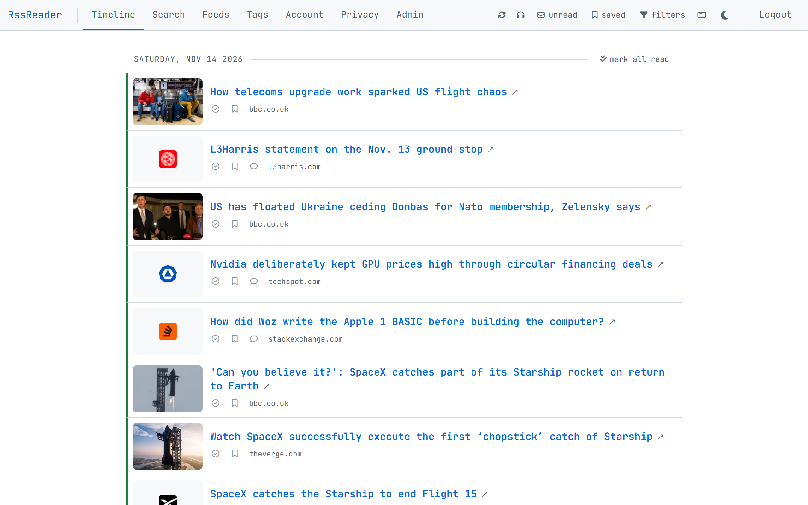

# RSS Reader

A simple browser-based RSS reader, live at <https://rss.brandonchastain.com>.

## Features

- 🗞️ Subscribe to RSS and Atom feeds
- 📰 Browse recent posts in an infinite-scroll feed
- 🏷️ Categorize feeds using **tags**
- 🚰 Curate your own feed with **tag filters** and **saved posts**
- 🔍 **Search** for posts
- 📥 **Import and export** feeds to/from other reader apps
- 📱 Responsive design for mobile & desktop

## Layout

| Path | What |
|---|---|
| `src/Server` | ASP.NET Core API, SQLite database, sign-in, feed refresh |
| `src/WasmApp` | Blazor WebAssembly frontend (static files) |
| `src/Shared` | Contracts shared by both |
| `infrastructure` | Azure Bicep template and Litestream config |
| `test/` | Unit tests, Playwright e2e, Docker durability test, k6 load scenarios |

## Docs

- [ARCHITECTURE.md](ARCHITECTURE.md): how the pieces fit and how data is kept safe
- [CLAUDE.md](CLAUDE.md): build, test and deploy commands, and the rules for changes
